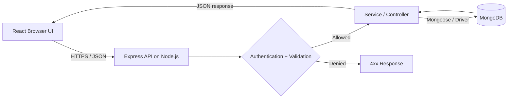

<a id="top"></a>

<div align="center">

# 🚀 MERN Stack Full-Stack Interview Questions & Answers

### 💻 Top 100 Questions (2026) · Beginner → Advanced · Code with Jamshed

**MongoDB · Express.js · React · Node.js · APIs · Authentication · Security · System Design**

[](https://www.mongodb.com/mern-stack)


[](LICENSE)

### ✨ Code with Jamshed

*Easy Indian English · Practical snippets · Interview tips · Full-stack scenarios*

[📚 Start Learning](#toc) · [⚡ Quick Revision](#quick-revision) · [🗓️ Study Plan](#study-plan) · [🤝 Contribute](CONTRIBUTING.md)

</div>

---

> **Who is this for?** Freshers, frontend developers moving into full-stack work, Node.js developers, and MERN engineers preparing for technical interviews. Every answer uses simple Indian English and real project thinking.
>
> **How to use code:** Snippets are focused interview examples, **not 100 standalone applications**. Some assume existing imports, an Express `app`, a React component, models, test tools, or an authenticated `req.user`. Install relevant packages and add surrounding setup before running them. Security snippets illustrate individual defences, not a complete production security configuration.

## 📌 At a glance

| 📘 Resource | ✅ Included |
|---|---|
| Questions and answers | **100**, arranged in **10 modules** |
| Code samples | **100**, with language-labelled snippets |
| Difficulty | **Beginner → Intermediate → Advanced** |
| Interview tips | **One practical follow-up tip per question** |
| Bonus | Architecture flow, quick revision, scenarios, study plan |
| Author | **Code with Jamshed** · [@Jamshed7664](https://github.com/Jamshed7664) |

<a id="toc"></a>

## 🧭 Table of Contents

| # | Module | Questions | Go to section |
|:--:|---|:--:|---|
| 01 | **MERN Fundamentals & Architecture** | Q001–Q010 | [Open module](#module-1) |
| 02 | **JavaScript, Tooling & Project Structure** | Q011–Q020 | [Open module](#module-2) |
| 03 | **React Fundamentals & Hooks** | Q021–Q030 | [Open module](#module-3) |
| 04 | **React Data Flow, Routing & Performance** | Q031–Q040 | [Open module](#module-4) |
| 05 | **Node.js Runtime & Async Programming** | Q041–Q050 | [Open module](#module-5) |
| 06 | **Express.js & REST API Design** | Q051–Q060 | [Open module](#module-6) |
| 07 | **MongoDB Data Modeling & Queries** | Q061–Q070 | [Open module](#module-7) |
| 08 | **Mongoose, Indexes & Transactions** | Q071–Q080 | [Open module](#module-8) |
| 09 | **Authentication, Security & Authorization** | Q081–Q090 | [Open module](#module-9) |
| 10 | **Testing, Deployment & Full-Stack Scenarios** | Q091–Q100 | [Open module](#module-10) |

<details>
<summary><strong>🔎 Show direct links to all 100 interview questions</strong></summary>

- [Q001. What is the MERN stack?](#q001)
- [Q002. How does a request travel through a MERN app?](#q002)
- [Q003. What is the difference between frontend and backend?](#q003)
- [Q004. Why use REST APIs in MERN?](#q004)
- [Q005. What is JSON and why is it used?](#q005)
- [Q006. What is a monorepo for a MERN project?](#q006)
- [Q007. What is the difference between development and production?](#q007)
- [Q008. What are environment variables?](#q008)
- [Q009. What are common MERN application layers?](#q009)
- [Q010. How do you design a task-management MERN app?](#q010)
- [Q011. What is the difference between let, const and var?](#q011)
- [Q012. What is destructuring in JavaScript?](#q012)
- [Q013. What are spread and rest operators?](#q013)
- [Q014. What is async/await?](#q014)
- [Q015. When would you use Promise.all?](#q015)
- [Q016. Why do we use TypeScript in MERN?](#q016)
- [Q017. What is npm and package.json?](#q017)
- [Q018. What is the difference between dependencies and devDependencies?](#q018)
- [Q019. What is CORS and why does it occur?](#q019)
- [Q020. What should go in a MERN .gitignore?](#q020)
- [Q021. What are React components?](#q021)
- [Q022. What is JSX?](#q022)
- [Q023. What is the difference between props and state?](#q023)
- [Q024. How does useState work?](#q024)
- [Q025. When should you use useEffect?](#q025)
- [Q026. What is useRef?](#q026)
- [Q027. What is useMemo?](#q027)
- [Q028. What is useCallback?](#q028)
- [Q029. What is the Context API?](#q029)
- [Q030. Why are keys important while rendering lists?](#q030)
- [Q031. How can React call an Express API?](#q031)
- [Q032. How do you fetch data safely in useEffect?](#q032)
- [Q033. What is a controlled form component?](#q033)
- [Q034. How do you implement React Router?](#q034)
- [Q035. What is prop drilling and how can you avoid it?](#q035)
- [Q036. What is optimistic UI?](#q036)
- [Q037. How do you implement debounced search?](#q037)
- [Q038. What is React.lazy and Suspense?](#q038)
- [Q039. How do you prevent unnecessary renders?](#q039)
- [Q040. What is the difference between client state and server state?](#q040)
- [Q041. What is Node.js?](#q041)
- [Q042. What is the Node.js event loop?](#q042)
- [Q043. What is the difference between synchronous and asynchronous code?](#q043)
- [Q044. What are CommonJS and ES modules?](#q044)
- [Q045. What is the difference between process.nextTick and setTimeout?](#q045)
- [Q046. How do you handle errors in async Node.js functions?](#q046)
- [Q047. What are streams in Node.js?](#q047)
- [Q048. What is the Buffer class?](#q048)
- [Q049. What is worker_threads?](#q049)
- [Q050. How do you make a Node.js process production-ready?](#q050)
- [Q051. How do you create a basic Express API?](#q051)
- [Q052. What is Express middleware?](#q052)
- [Q053. How do you parse JSON request bodies?](#q053)
- [Q054. What is the difference between req.params, req.query and req.body?](#q054)
- [Q055. How should REST status codes be used?](#q055)
- [Q056. How does Express 5 handle async route errors?](#q056)
- [Q057. How do you create centralized error middleware?](#q057)
- [Q058. What is pagination in an API?](#q058)
- [Q059. What is API versioning?](#q059)
- [Q060. How do you validate Express requests?](#q060)
- [Q061. What is MongoDB?](#q061)
- [Q062. What is the difference between collection and document?](#q062)
- [Q063. How do you perform CRUD in MongoDB?](#q063)
- [Q064. What is an ObjectId?](#q064)
- [Q065. What are embedding and referencing?](#q065)
- [Q066. How do you filter and sort documents?](#q066)
- [Q067. What is the aggregation pipeline?](#q067)
- [Q068. What does $lookup do?](#q068)
- [Q069. How do you implement search in MongoDB?](#q069)
- [Q070. How do you make queries fast in MongoDB?](#q070)
- [Q071. What is Mongoose?](#q071)
- [Q072. How do you connect Express to MongoDB?](#q072)
- [Q073. What is a Mongoose schema?](#q073)
- [Q074. How do you validate and sanitize data in Mongoose?](#q074)
- [Q075. What is populate in Mongoose?](#q075)
- [Q076. What are unique indexes?](#q076)
- [Q077. What is a compound index?](#q077)
- [Q078. When do we need MongoDB transactions?](#q078)
- [Q079. What is the N+1 query problem?](#q079)
- [Q080. What is the difference between lean() and normal Mongoose documents?](#q080)
- [Q081. What is authentication versus authorization?](#q081)
- [Q082. How do JWT access tokens work?](#q082)
- [Q083. Where should login tokens be stored?](#q083)
- [Q084. How should passwords be stored?](#q084)
- [Q085. How do you implement role-based access control?](#q085)
- [Q086. What is XSS and how do you reduce it?](#q086)
- [Q087. What is CSRF?](#q087)
- [Q088. What is NoSQL injection?](#q088)
- [Q089. How do you protect an Express API?](#q089)
- [Q090. How do you secure multi-user MongoDB queries?](#q090)
- [Q091. How do you test an Express API?](#q091)
- [Q092. How do you test React components?](#q092)
- [Q093. What is integration testing in a MERN application?](#q093)
- [Q094. What is end-to-end testing?](#q094)
- [Q095. How do you deploy a MERN application?](#q095)
- [Q096. What is a CI/CD pipeline?](#q096)
- [Q097. How do you debug a slow MERN application?](#q097)
- [Q098. How would you design a scalable notifications feature?](#q098)
- [Q099. How would you implement file upload safely?](#q099)
- [Q100. Explain a complete login-to-dashboard flow.](#q100)

</details>

---

## 🗺️ MERN request flow



> **Remember:** React is never a trusted authorization boundary. API permissions and database ownership checks must happen on the backend.

---

<a id="module-1"></a>

## 01. MERN Fundamentals & Architecture

*How the stack works, end-to-end requests and system boundaries*

<a id="q001"></a>

### Q001. What is the MERN stack?

**Level:** 🟢 Beginner

**Easy answer:** MERN means **MongoDB, Express.js, React, and Node.js**. React builds the browser UI, Express provides HTTP routes, Node.js executes backend JavaScript, and MongoDB stores data. It is a stack choice, not a fixed architecture.

**💻 Example**

```js
const stack = { database: 'MongoDB', api: 'Express', ui: 'React', runtime: 'Node.js' };
console.log(Object.values(stack).join(' + '));
```

**🎯 Interview tip:** Say which part runs in the browser and which runs on the server.

[↑ Back to topics](#toc)

---

<a id="q002"></a>

### Q002. How does a request travel through a MERN app?

**Level:** 🟢 Beginner

**Easy answer:** For example, the user clicks **View Tasks** in React. The browser calls `GET /api/tasks`, Express handles it, a database query loads tasks, and the API responds with JSON. React then updates the screen.

**💻 Example**

```js
// React side
const response = await fetch('/api/tasks');
if (!response.ok) throw new Error('Could not load tasks');
const tasks = await response.json();
console.log(tasks);
```

**🎯 Interview tip:** Mention authentication, validation and error handling between API and DB.

[↑ Back to topics](#toc)

---

<a id="q003"></a>

### Q003. What is the difference between frontend and backend?

**Level:** 🟢 Beginner

**Easy answer:** **Frontend** handles what people see and interact with. **Backend** enforces business rules, checks permissions, talks to the database and returns responses. Browser-side checks improve UX but cannot replace server-side validation.

**💻 Example**

```js
// Browser: show a helpful message
if (!email.includes('@')) console.log('Enter a valid email');
// Server must still validate email before saving it.
```

**🎯 Interview tip:** Never depend on a hidden React button for authorization.

[↑ Back to topics](#toc)

---

<a id="q004"></a>

### Q004. Why use REST APIs in MERN?

**Level:** 🟢 Beginner

**Easy answer:** REST-style APIs give frontend and backend a clear contract with resource URLs, HTTP methods and status codes. This makes browser, mobile and testing clients able to use the same backend.

**💻 Example**

```js
// Example resource design
// GET    /api/tasks
// POST   /api/tasks
// GET    /api/tasks/:id
// PATCH  /api/tasks/:id
// DELETE /api/tasks/:id
```

**🎯 Interview tip:** Use nouns in URLs and verbs through HTTP methods.

[↑ Back to topics](#toc)

---

<a id="q005"></a>

### Q005. What is JSON and why is it used?

**Level:** 🟢 Beginner

**Easy answer:** JSON is a lightweight text format for structured data. React and Express commonly exchange JSON because JavaScript can parse it easily; JSON does not carry functions or `undefined` values.

**💻 Example**

```js
const payload = { title: 'Prepare interview', done: false };
const text = JSON.stringify(payload);
console.log(JSON.parse(text).title); // Prepare interview
```

**🎯 Interview tip:** Know the difference between a JavaScript object and JSON text.

[↑ Back to topics](#toc)

---

<a id="q006"></a>

### Q006. What is a monorepo for a MERN project?

**Level:** 🟢 Beginner

**Easy answer:** A **monorepo** stores frontend and backend in one Git repository, usually in `client/` and `server/`. It helps coordinate changes, although deployments can still be independent.

**💻 Example**

```text
mern-app/
  client/          # React application
  server/          # Express API
  README.md
  .gitignore
```

**🎯 Interview tip:** For interviews, explain the trade-off between one repo and separate repos.

[↑ Back to topics](#toc)

---

<a id="q007"></a>

### Q007. What is the difference between development and production?

**Level:** 🟢 Beginner

**Easy answer:** Development focuses on fast feedback, hot reload and debugging. Production focuses on secure configuration, optimized frontend builds, logs, health checks and reliable hosting. Neither environment should contain secrets in client code.

**💻 Example**

```js
const isProduction = process.env.NODE_ENV === 'production';
console.log(isProduction ? 'Production mode' : 'Development mode');
```

**🎯 Interview tip:** Talk about different environment variables rather than different source files.

[↑ Back to topics](#toc)

---

<a id="q008"></a>

### Q008. What are environment variables?

**Level:** 🟢 Beginner

**Easy answer:** Environment variables provide deployment-specific settings such as DB URLs or API ports. Node reads them through `process.env`. Only values intended to be public should be exposed to a React/Vite build.

**💻 Example**

```js
// Server: set MONGO_URI in your environment or .env file
import 'dotenv/config';
if (!process.env.MONGO_URI) throw new Error('MONGO_URI is missing');
```

**🎯 Interview tip:** Never commit `.env` secrets. Use `.env.example` with placeholders.

[↑ Back to topics](#toc)

---

<a id="q009"></a>

### Q009. What are common MERN application layers?

**Level:** 🟢 Beginner

**Easy answer:** A practical backend separates **route → middleware → controller/service → model/database**. Each layer has one job, making testing and changes easier. Small applications may combine layers; do not over-engineer.

**💻 Example**

```js
// Example flow (conceptual)
router.get('/tasks', requireAuth, taskController.list);
// list() calls taskService, which uses Task model.
```

**🎯 Interview tip:** Explain a real change, like adding a filter without touching every layer.

[↑ Back to topics](#toc)

---

<a id="q010"></a>

### Q010. How do you design a task-management MERN app?

**Level:** 🟢 Beginner

**Easy answer:** Start with users and tasks, define ownership rules, plan endpoints, create MongoDB indexes for common queries, then build React pages and test the whole flow. Keep `userId` on tasks to enforce isolation.

**💻 Example**

```js
// Example task document
const task = {
  title: 'Read docs',
  ownerId: 'user-123',
  status: 'todo',
  createdAt: new Date()
};
```

**🎯 Interview tip:** State assumptions about scale, auth and deployment before designing.

[↑ Back to topics](#toc)

---


<a id="module-2"></a>

## 02. JavaScript, Tooling & Project Structure

*Language essentials and maintainable projects*

<a id="q011"></a>

### Q011. What is the difference between let, const and var?

**Level:** 🟢 Beginner

**Easy answer:** `const` blocks reassignment, `let` allows reassignment, and `var` is function-scoped. Prefer `const` by default and `let` when values change. `const` does not make objects deeply immutable.

**💻 Example**

```js
const user = { name: 'Asha' };
user.name = 'Riya'; // allowed
let attempts = 0;
attempts += 1;
console.log(user.name, attempts);
```

**🎯 Interview tip:** Mention block scope and temporal dead zone for `let`/`const`.

[↑ Back to topics](#toc)

---

<a id="q012"></a>

### Q012. What is destructuring in JavaScript?

**Level:** 🟢 Beginner

**Easy answer:** Destructuring takes values from arrays or properties from objects into variables. It makes React props and API response handling cleaner.

**💻 Example**

```js
const profile = { name: 'Riya', role: 'developer' };
const { name, role } = profile;
console.log(name, role);
```

**🎯 Interview tip:** Use defaults when API fields can be missing.

[↑ Back to topics](#toc)

---

<a id="q013"></a>

### Q013. What are spread and rest operators?

**Level:** 🟢 Beginner

**Easy answer:** Both use `...` but do different jobs. **Spread** expands values into another collection; **rest** collects remaining values into one variable. Shallow copying does not clone nested objects.

**💻 Example**

```js
const a = [1, 2];
const b = [...a, 3]; // spread
const total = (...nums) => nums.reduce((s, n) => s + n, 0); // rest
console.log(b, total(1, 2, 3));
```

**🎯 Interview tip:** Be ready to explain shallow copy and reference sharing.

[↑ Back to topics](#toc)

---

<a id="q014"></a>

### Q014. What is async/await?

**Level:** 🟢 Beginner

**Easy answer:** `async/await` is readable syntax over Promises. `await` pauses the current async function until a Promise settles; it does not block the entire Node.js event loop. Handle rejections.

**💻 Example**

```js
async function loadUser() {
  try {
    const res = await fetch('/api/me');
    if (!res.ok) throw new Error('Request failed');
    return await res.json();
  } catch (err) {
    console.error(err.message);
  }
}
```

**🎯 Interview tip:** Know how Promise rejection becomes an exception with `await`.

[↑ Back to topics](#toc)

---

<a id="q015"></a>

### Q015. When would you use Promise.all?

**Level:** 🟢 Beginner

**Easy answer:** Use `Promise.all` for independent requests that can run together. It resolves when all complete and rejects when any input rejects; it does not automatically cancel other requests.

**💻 Example**

```js
const [users, tasks] = await Promise.all([
  fetch('/api/users').then(r => r.json()),
  fetch('/api/tasks').then(r => r.json())
]);
console.log(users.length, tasks.length);
```

**🎯 Interview tip:** Use `Promise.allSettled` when partial success matters.

[↑ Back to topics](#toc)

---

<a id="q016"></a>

### Q016. Why do we use TypeScript in MERN?

**Level:** 🟢 Beginner

**Easy answer:** TypeScript catches many type mistakes before runtime and makes API shapes easier to understand. It improves developer experience but **does not validate** untrusted HTTP input at runtime.

**💻 Example**

```ts
type Task = { id: string; title: string; done: boolean };
const task: Task = { id: '1', title: 'Learn TS', done: false };
console.log(task.title);
```

**🎯 Interview tip:** Mention runtime validators such as Zod or a schema library.

[↑ Back to topics](#toc)

---

<a id="q017"></a>

### Q017. What is npm and package.json?

**Level:** 🟢 Beginner

**Easy answer:** `npm` installs JavaScript packages and runs scripts. `package.json` tracks dependencies and commands, while the lockfile pins resolved dependency versions for repeatable installations.

**💻 Example**

```json
{
  "scripts": { "dev": "vite", "build": "vite build" },
  "dependencies": { "react": "^19.0.0" }
}
```

**🎯 Interview tip:** Prefer `npm ci` in CI when a compatible lockfile exists.

[↑ Back to topics](#toc)

---

<a id="q018"></a>

### Q018. What is the difference between dependencies and devDependencies?

**Level:** 🟢 Beginner

**Easy answer:** `dependencies` are normally needed by the application at runtime; `devDependencies` support development/build/test tasks. Frontend bundlers still bundle imported production code into built assets.

**💻 Example**

```bash
npm install express mongoose
npm install --save-dev nodemon eslint
```

**🎯 Interview tip:** Explain the difference between local development tooling and runtime packages.

[↑ Back to topics](#toc)

---

<a id="q019"></a>

### Q019. What is CORS and why does it occur?

**Level:** 🟢 Beginner

**Easy answer:** CORS is a browser security mechanism for cross-origin requests. When React and Express run on different origins, the API must allow the intended frontend origin, including required credentials and methods.

**💻 Example**

```js
import cors from 'cors';
app.use(cors({
  origin: 'http://localhost:5173',
  credentials: true
}));
```

**🎯 Interview tip:** CORS is not authentication and does not restrict non-browser clients.

[↑ Back to topics](#toc)

---

<a id="q020"></a>

### Q020. What should go in a MERN .gitignore?

**Level:** 🟢 Beginner

**Easy answer:** Ignore generated dependencies, build output, temporary files, and local secrets. Share `.env.example` to document required variables without committing real values.

**💻 Example**

```gitignore
node_modules/
.env
.env.*.local
dist/
build/
coverage/
*.log
```

**🎯 Interview tip:** Test `git status` before every first commit to avoid leaking secrets.

[↑ Back to topics](#toc)

---


<a id="module-3"></a>

## 03. React Fundamentals & Hooks

*UI building, state and component behaviour*

<a id="q021"></a>

### Q021. What are React components?

**Level:** 🟢 Beginner

**Easy answer:** Components are reusable functions that return UI. Break large pages into smaller pieces such as Header, TaskList and TaskItem, with clear props and single responsibilities.

**💻 Example**

```jsx
function Welcome({ name }) {
  return <h2>Hello, {name}</h2>;
}
// <Welcome name="Jamshed" />
```

**🎯 Interview tip:** Prefer composition over giant all-in-one components.

[↑ Back to topics](#toc)

---

<a id="q022"></a>

### Q022. What is JSX?

**Level:** 🟢 Beginner

**Easy answer:** JSX is a syntax extension that lets you describe React UI with HTML-like markup inside JavaScript. It is transformed by the build tool; browsers do not directly execute JSX syntax.

**💻 Example**

```jsx
const user = { name: 'Asha' };
const heading = <h1>Welcome, {user.name}</h1>;
```

**🎯 Interview tip:** Remember `className`, `htmlFor` and curly braces for expressions.

[↑ Back to topics](#toc)

---

<a id="q023"></a>

### Q023. What is the difference between props and state?

**Level:** 🟢 Beginner

**Easy answer:** **Props** are inputs supplied by a parent; **state** is component-owned data that can change. Never mutate props directly. Changing state triggers React to schedule an updated render.

**💻 Example**

```jsx
function Counter({ step = 1 }) {
  const [count, setCount] = React.useState(0);
  return <button onClick={() => setCount(c => c + step)}>{count}</button>;
}
```

**🎯 Interview tip:** Mention one-way data flow and functional state updates.

[↑ Back to topics](#toc)

---

<a id="q024"></a>

### Q024. How does useState work?

**Level:** 🟢 Beginner

**Easy answer:** `useState` returns the current state and a setter. A setter requests a new render; the current render still sees its own snapshot. For next state based on previous state, use an updater function.

**💻 Example**

```jsx
const [items, setItems] = React.useState([]);
function addItem(item) {
  setItems(current => [...current, item]);
}
```

**🎯 Interview tip:** Do not directly modify the existing array or object.

[↑ Back to topics](#toc)

---

<a id="q025"></a>

### Q025. When should you use useEffect?

**Level:** 🟢 Beginner

**Easy answer:** `useEffect` synchronizes a component with external systems like timers, subscriptions or requests. It is not required for normal calculations that can happen during rendering.

**💻 Example**

```jsx
React.useEffect(() => {
  const timer = setInterval(() => console.log('tick'), 1000);
  return () => clearInterval(timer);
}, []);
```

**🎯 Interview tip:** Always discuss effect cleanup and dependency arrays.

[↑ Back to topics](#toc)

---

<a id="q026"></a>

### Q026. What is useRef?

**Level:** 🟡 Intermediate

**Easy answer:** `useRef` keeps a mutable value across renders without causing a rerender when it changes. It is commonly used to hold DOM references or timer IDs.

**💻 Example**

```jsx
function Search() {
  const inputRef = React.useRef(null);
  return <><input ref={inputRef} />
    <button onClick={() => inputRef.current?.focus()}>Focus</button></>;
}
```

**🎯 Interview tip:** Do not use refs instead of state for values that must appear on screen.

[↑ Back to topics](#toc)

---

<a id="q027"></a>

### Q027. What is useMemo?

**Level:** 🟡 Intermediate

**Easy answer:** `useMemo` caches a calculated value until listed dependencies change. It may help with expensive derived work, but unnecessary memoization adds complexity and is not always faster.

**💻 Example**

```jsx
const visible = React.useMemo(
  () => tasks.filter(task => task.status === filter),
  [tasks, filter]
);
```

**🎯 Interview tip:** Profile before optimizing; understand referential equality.

[↑ Back to topics](#toc)

---

<a id="q028"></a>

### Q028. What is useCallback?

**Level:** 🟡 Intermediate

**Easy answer:** `useCallback` keeps a function reference stable between renders when dependencies stay same. It is useful in selected memoized component or effect scenarios, not automatically for every function.

**💻 Example**

```jsx
const handleSave = React.useCallback(
  (task) => onSave(task),
  [onSave]
);
```

**🎯 Interview tip:** `useCallback(fn, deps)` memoizes a reference, not the function result.

[↑ Back to topics](#toc)

---

<a id="q029"></a>

### Q029. What is the Context API?

**Level:** 🟡 Intermediate

**Easy answer:** Context makes a value available to components below a provider without passing it through every intermediate component. Use it for cross-cutting values like theme or current user; broad context updates can rerender consumers.

**💻 Example**

```jsx
const ThemeContext = React.createContext('light');
function App() {
  return <ThemeContext.Provider value="dark"><Page /></ThemeContext.Provider>;
}
```

**🎯 Interview tip:** Context is not a replacement for every form or server-state library.

[↑ Back to topics](#toc)

---

<a id="q030"></a>

### Q030. Why are keys important while rendering lists?

**Level:** 🟡 Intermediate

**Easy answer:** Keys help React identify which item remains, moves, or disappears between renders. Prefer a stable unique database ID, not array index when items can reorder or be deleted.

**💻 Example**

```jsx
function TaskList({ tasks }) {
  return <ul>{tasks.map(task =>
    <li key={task._id}>{task.title}</li>
  )}</ul>;
}
```

**🎯 Interview tip:** Keys are for sibling identity; they are not passed as ordinary props.

[↑ Back to topics](#toc)

---


<a id="module-4"></a>

## 04. React Data Flow, Routing & Performance

*Fetching, navigation and rendering performance*

<a id="q031"></a>

### Q031. How can React call an Express API?

**Level:** 🟡 Intermediate

**Easy answer:** The browser uses `fetch` or an HTTP client to request an endpoint. Check status codes, parse the body, and represent loading/errors in the UI. Put the base URL in configuration.

**💻 Example**

```js
async function getTasks() {
  const res = await fetch('/api/tasks');
  if (!res.ok) throw new Error(`HTTP ${res.status}`);
  return res.json();
}
```

**🎯 Interview tip:** Handle network failures and non-2xx responses separately.

[↑ Back to topics](#toc)

---

<a id="q032"></a>

### Q032. How do you fetch data safely in useEffect?

**Level:** 🟡 Intermediate

**Easy answer:** Use an effect for client-side fetching when appropriate, and avoid setting obsolete results after a component unmounts or request changes. `AbortController` is a practical solution.

**💻 Example**

```jsx
React.useEffect(() => {
  const controller = new AbortController();
  fetch('/api/tasks', { signal: controller.signal })
    .then(r => { if (!r.ok) throw new Error('Fetch failed'); return r.json(); })
    .then(setTasks)
    .catch(e => { if (e.name !== 'AbortError') setError(e.message); });
  return () => controller.abort();
}, []);
```

**🎯 Interview tip:** For large apps, consider a caching/data-fetching library.

[↑ Back to topics](#toc)

---

<a id="q033"></a>

### Q033. What is a controlled form component?

**Level:** 🟡 Intermediate

**Easy answer:** A controlled form field gets its value from React state and updates that state on user input. It makes validation, conditional UI and submission logic straightforward.

**💻 Example**

```jsx
function EmailInput() {
  const [email, setEmail] = React.useState('');
  return <input value={email} onChange={e => setEmail(e.target.value)} />;
}
```

**🎯 Interview tip:** Server must validate input even if React has validation.

[↑ Back to topics](#toc)

---

<a id="q034"></a>

### Q034. How do you implement React Router?

**Level:** 🟡 Intermediate

**Easy answer:** React Router maps URLs to components and supports client navigation. It is a routing library; protected pages still need server-side authorization for API data.

**💻 Example**

```jsx
import { BrowserRouter, Routes, Route } from 'react-router-dom';
<BrowserRouter>
  <Routes>
    <Route path="/" element={<Home />} />
    <Route path="/tasks/:id" element={<TaskDetails />} />
  </Routes>
</BrowserRouter>
```

**🎯 Interview tip:** Explain dynamic URL params and 404 routes.

[↑ Back to topics](#toc)

---

<a id="q035"></a>

### Q035. What is prop drilling and how can you avoid it?

**Level:** 🟡 Intermediate

**Easy answer:** Prop drilling happens when intermediate components forward data they do not use. First try better component composition; Context or a state store can help when data truly belongs to many distant components.

**💻 Example**

```jsx
// Composition lets Child receive its own data directly
function Page({ user }) {
  return <Layout sidebar={<UserCard user={user} />} />;
}
```

**🎯 Interview tip:** Do not add global state for a single local form.

[↑ Back to topics](#toc)

---

<a id="q036"></a>

### Q036. What is optimistic UI?

**Level:** 🟡 Intermediate

**Easy answer:** Optimistic UI updates the screen before a server operation finishes, making interactions feel faster. If the request fails, revert or reconcile the change.

**💻 Example**

```jsx
async function toggleTask(task) {
  setTasks(xs => xs.map(x => x.id === task.id ? { ...x, done: !x.done } : x));
  try { await apiToggle(task.id); }
  catch { setTasks(xs => xs.map(x => x.id === task.id ? task : x)); }
}
```

**🎯 Interview tip:** For overlapping edits, use a query cache or rollback snapshot carefully.

[↑ Back to topics](#toc)

---

<a id="q037"></a>

### Q037. How do you implement debounced search?

**Level:** 🟡 Intermediate

**Easy answer:** Debouncing waits until the user stops typing for a short period before starting work. This reduces unnecessary API calls; still cancel stale requests or ignore stale results.

**💻 Example**

```jsx
React.useEffect(() => {
  const timer = setTimeout(() => setSearchTerm(input), 350);
  return () => clearTimeout(timer);
}, [input]);
```

**🎯 Interview tip:** Debounce reduces frequency; it does not replace pagination or indexing.

[↑ Back to topics](#toc)

---

<a id="q038"></a>

### Q038. What is React.lazy and Suspense?

**Level:** 🟡 Intermediate

**Easy answer:** `React.lazy` lets a component load only when needed. `Suspense` renders a fallback while that code is loading. This can reduce initial JavaScript size.

**💻 Example**

```jsx
const AdminPage = React.lazy(() => import('./AdminPage.jsx'));
function App() {
  return <React.Suspense fallback={<p>Loading...</p>}><AdminPage /></React.Suspense>;
}
```

**🎯 Interview tip:** Combine lazy loading with route-level code splitting.

[↑ Back to topics](#toc)

---

<a id="q039"></a>

### Q039. How do you prevent unnecessary renders?

**Level:** 🟡 Intermediate

**Easy answer:** Keep state close to where it is used, avoid redundant derived state, keep object identities stable when helpful, and measure before using `memo` or memoization hooks. Context design also matters.

**💻 Example**

```jsx
const TaskRow = React.memo(function TaskRow({ task }) {
  return <li>{task.title}</li>;
});
```

**🎯 Interview tip:** Performance discussions should mention React Profiler and actual measurements.

[↑ Back to topics](#toc)

---

<a id="q040"></a>

### Q040. What is the difference between client state and server state?

**Level:** 🟡 Intermediate

**Easy answer:** Client state is local UI information, like an open modal. Server state comes from a backend and needs caching, refetching and invalidation. Mixing both in one large global store can create bugs.

**💻 Example**

```jsx
const [isModalOpen, setModalOpen] = React.useState(false);
// Task data: fetch and cache using your API/query layer.
```

**🎯 Interview tip:** Mention query cache keys, stale data and mutation invalidation.

[↑ Back to topics](#toc)

---


<a id="module-5"></a>

## 05. Node.js Runtime & Async Programming

*The server runtime and non-blocking I/O*

<a id="q041"></a>

### Q041. What is Node.js?

**Level:** 🟡 Intermediate

**Easy answer:** Node.js is a JavaScript runtime used outside the browser, often for HTTP APIs. It has an event loop, asynchronous I/O APIs and a large package ecosystem. JavaScript callbacks usually run on its main thread.

**💻 Example**

```js
console.log('Running on Node', process.version);
console.log('Platform:', process.platform);
```

**🎯 Interview tip:** Node.js is not a framework; Express is a framework on top of Node.

[↑ Back to topics](#toc)

---

<a id="q042"></a>

### Q042. What is the Node.js event loop?

**Level:** 🟡 Intermediate

**Easy answer:** The event loop schedules callbacks after synchronous code finishes and processes asynchronous completions through different phases. Promise callbacks run as microtasks. Exact scheduling can depend on context, so avoid relying on accidental order.

**💻 Example**

```js
console.log('A');
setTimeout(() => console.log('C'), 0);
Promise.resolve().then(() => console.log('B'));
// Output: A, B, C
```

**🎯 Interview tip:** Know why synchronous CPU-heavy work can delay all requests.

[↑ Back to topics](#toc)

---

<a id="q043"></a>

### Q043. What is the difference between synchronous and asynchronous code?

**Level:** 🟡 Intermediate

**Easy answer:** Synchronous code finishes before the next statement. Asynchronous APIs let other work progress while waiting for I/O, such as reading files or querying MongoDB.

**💻 Example**

```js
import { readFile } from 'node:fs/promises';
async function readConfig() {
  const text = await readFile('./config.json', 'utf8');
  return JSON.parse(text);
}
```

**🎯 Interview tip:** `await` does not magically make CPU work non-blocking.

[↑ Back to topics](#toc)

---

<a id="q044"></a>

### Q044. What are CommonJS and ES modules?

**Level:** 🟡 Intermediate

**Easy answer:** CommonJS uses `require` and `module.exports`. ES modules use `import` and `export`. Node.js supports both, with configuration rules for file extensions and `package.json`.

**💻 Example**

```js
// package.json: { "type": "module" }
import express from 'express';
export const add = (a, b) => a + b;
```

**🎯 Interview tip:** Pick one module system consistently per project.

[↑ Back to topics](#toc)

---

<a id="q045"></a>

### Q045. What is the difference between process.nextTick and setTimeout?

**Level:** 🟡 Intermediate

**Easy answer:** `process.nextTick` schedules work immediately after the current operation before the event loop continues. `setTimeout` runs a timer callback no earlier than its threshold. Excessive next-tick recursion can starve I/O.

**💻 Example**

```js
process.nextTick(() => console.log('nextTick'));
setTimeout(() => console.log('timer'), 0);
```

**🎯 Interview tip:** Do not claim every scheduling order is identical across all contexts.

[↑ Back to topics](#toc)

---

<a id="q046"></a>

### Q046. How do you handle errors in async Node.js functions?

**Level:** 🟡 Intermediate

**Easy answer:** Catch expected failures at a meaningful boundary, log useful details internally, and return safe messages to callers. Never silently swallow a rejected Promise.

**💻 Example**

```js
async function readUser(id) {
  try { return await userService.getById(id); }
  catch (err) {
    console.error('readUser failed', err);
    throw err;
  }
}
```

**🎯 Interview tip:** Distinguish programmer errors from operational failures.

[↑ Back to topics](#toc)

---

<a id="q047"></a>

### Q047. What are streams in Node.js?

**Level:** 🟡 Intermediate

**Easy answer:** Streams process data in chunks instead of loading everything into memory. This is useful for large uploads, downloads and log processing. Proper backpressure prevents overwhelming the destination.

**💻 Example**

```js
import { createReadStream, createWriteStream } from 'node:fs';
import { pipeline } from 'node:stream/promises';
await pipeline(
  createReadStream('large.csv'),
  createWriteStream('copy.csv')
);
```

**🎯 Interview tip:** Use `pipeline` for error propagation and cleanup.

[↑ Back to topics](#toc)

---

<a id="q048"></a>

### Q048. What is the Buffer class?

**Level:** 🟡 Intermediate

**Easy answer:** `Buffer` represents raw bytes in Node.js. It is used with files, sockets and binary data. Encoding matters: a string character is not always equal to one byte.

**💻 Example**

```js
const bytes = Buffer.from('Hello', 'utf8');
console.log(bytes.length); // 5
console.log(bytes.toString('hex')); // 48656c6c6f
```

**🎯 Interview tip:** Know Buffer versus readable streams for memory usage.

[↑ Back to topics](#toc)

---

<a id="q049"></a>

### Q049. What is worker_threads?

**Level:** 🟡 Intermediate

**Easy answer:** Worker threads run JavaScript on separate threads. They are useful for CPU-intensive tasks, while regular asynchronous I/O usually does not need workers.

**💻 Example**

```js
import { Worker } from 'node:worker_threads';
const worker = new Worker('./cpu-worker.js');
worker.on('message', result => console.log(result));
worker.on('error', console.error);
```

**🎯 Interview tip:** Explain when a background job queue may be more suitable than a worker.

[↑ Back to topics](#toc)

---

<a id="q050"></a>

### Q050. How do you make a Node.js process production-ready?

**Level:** 🟡 Intermediate

**Easy answer:** Handle termination signals, stop accepting new work, close HTTP connections, and cleanly disconnect dependencies. Use logs, health checks and a process manager/container platform.

**💻 Example**

```js
const server = app.listen(process.env.PORT || 3000);
process.on('SIGTERM', () => {
  server.close(() => {
    mongoose.disconnect().finally(() => process.exit(0));
  });
});
```

**🎯 Interview tip:** Real apps also need shutdown timeouts and in-flight request handling.

[↑ Back to topics](#toc)

---


<a id="module-6"></a>

## 06. Express.js & REST API Design

*Routes, middleware and robust APIs*

<a id="q051"></a>

### Q051. How do you create a basic Express API?

**Level:** 🟡 Intermediate

**Easy answer:** Express registers route handlers and sends HTTP responses. A tiny health endpoint is useful for checking whether the web server can answer requests.

**💻 Example**

```js
import express from 'express';
const app = express();
app.get('/health', (req, res) => res.json({ status: 'ok' }));
app.listen(3000, () => console.log('Listening on 3000'));
```

**🎯 Interview tip:** Add database readiness checks separately if needed.

[↑ Back to topics](#toc)

---

<a id="q052"></a>

### Q052. What is Express middleware?

**Level:** 🟡 Intermediate

**Easy answer:** Middleware runs as part of the request pipeline. It can read or modify request data, end a response or call `next()` so another handler can run.

**💻 Example**

```js
app.use((req, res, next) => {
  console.log(req.method, req.path);
  next();
});
```

**🎯 Interview tip:** Order matters: middleware must usually be registered before routes.

[↑ Back to topics](#toc)

---

<a id="q053"></a>

### Q053. How do you parse JSON request bodies?

**Level:** 🟡 Intermediate

**Easy answer:** `express.json()` parses JSON requests and populates `req.body`. Apply size limits and validate the parsed data before using it.

**💻 Example**

```js
app.use(express.json({ limit: '100kb' }));
app.post('/api/tasks', (req, res) => {
  if (typeof req.body.title !== 'string') return res.sendStatus(400);
  res.status(201).json({ title: req.body.title });
});
```

**🎯 Interview tip:** Body parsing is not input validation.

[↑ Back to topics](#toc)

---

<a id="q054"></a>

### Q054. What is the difference between req.params, req.query and req.body?

**Level:** 🟡 Intermediate

**Easy answer:** `req.params` holds path values, `req.query` holds URL query parameters, and `req.body` holds submitted request content. Validate every field before DB access.

**💻 Example**

```js
app.get('/api/tasks/:id', (req, res) => {
  res.json({ id: req.params.id, filter: req.query.status ?? 'all' });
});
```

**🎯 Interview tip:** Query strings are strings/untrusted inputs; convert types carefully.

[↑ Back to topics](#toc)

---

<a id="q055"></a>

### Q055. How should REST status codes be used?

**Level:** 🟡 Intermediate

**Easy answer:** Use `200` for a successful read/update, `201` for creation, `204` for successful no-content deletion, `400` for bad input, `401` for unauthenticated, `403` for forbidden, `404` for missing, and `500` for unexpected server faults.

**💻 Example**

```js
app.post('/api/tasks', async (req, res) => {
  const task = await Task.create({ title: req.body.title });
  return res.status(201).json(task);
});
```

**🎯 Interview tip:** Do not reply with HTTP 200 for every type of error.

[↑ Back to topics](#toc)

---

<a id="q056"></a>

### Q056. How does Express 5 handle async route errors?

**Level:** 🟡 Intermediate

**Easy answer:** In Express 5, when a Promise-returning route handler rejects, the rejection is passed to error-handling middleware automatically. Keep centralized error responses, and do not accidentally send a second response.

**💻 Example**

```js
app.get('/api/tasks', async (req, res) => {
  const tasks = await Task.find(); // rejection reaches error handler
  res.json(tasks);
});
```

**🎯 Interview tip:** Know the difference from Express 4 applications that use wrappers/explicit `next(err)`.

[↑ Back to topics](#toc)

---

<a id="q057"></a>

### Q057. How do you create centralized error middleware?

**Level:** 🟡 Intermediate

**Easy answer:** Place a four-argument error middleware **after** routes. Respond with a safe message, log details server-side, and respect `res.headersSent`.

**💻 Example**

```js
app.use((err, req, res, next) => {
  if (res.headersSent) return next(err);
  console.error(err);
  res.status(500).json({ message: 'Internal server error' });
});
```

**🎯 Interview tip:** Avoid revealing stack traces, credentials or DB internals to clients.

[↑ Back to topics](#toc)

---

<a id="q058"></a>

### Q058. What is pagination in an API?

**Level:** 🟡 Intermediate

**Easy answer:** Pagination sends a limited number of records at a time. Offset pagination with `skip`/`limit` is easy; cursor pagination is often better for large or frequently changing datasets.

**💻 Example**

```js
const page = Math.max(1, Number(req.query.page) || 1);
const limit = Math.min(50, Math.max(1, Number(req.query.limit) || 10));
const tasks = await Task.find({ ownerId: req.user.id })
  .sort({ createdAt: -1, _id: -1 })
  .skip((page - 1) * limit).limit(limit);
```

**🎯 Interview tip:** Always cap page size and use a stable sort with supporting indexes.

[↑ Back to topics](#toc)

---

<a id="q059"></a>

### Q059. What is API versioning?

**Level:** 🟡 Intermediate

**Easy answer:** API versioning helps maintain old clients while rolling out breaking changes. Routes such as `/api/v1/tasks` are a simple approach; explicit contracts and deprecation policies matter more than the naming.

**💻 Example**

```js
app.use('/api/v1/tasks', v1TaskRouter);
app.use('/api/v2/tasks', v2TaskRouter);
```

**🎯 Interview tip:** Describe how you would migrate existing mobile or web clients.

[↑ Back to topics](#toc)

---

<a id="q060"></a>

### Q060. How do you validate Express requests?

**Level:** 🟡 Intermediate

**Easy answer:** Apply runtime validation for body, query and params before business logic. A schema validator can check types, lengths and allowed values; reject unexpected input where appropriate.

**💻 Example**

```js
import { z } from 'zod';
const schema = z.object({ title: z.string().trim().min(1).max(120) });
const parsed = schema.safeParse(req.body);
if (!parsed.success) return res.status(400).json({ message: 'Invalid task' });
const task = await Task.create(parsed.data);
```

**🎯 Interview tip:** Use a runtime schema even if the backend is written in TypeScript.

[↑ Back to topics](#toc)

---


<a id="module-7"></a>

## 07. MongoDB Data Modeling & Queries

*Documents, CRUD and aggregations*

<a id="q061"></a>

### Q061. What is MongoDB?

**Level:** 🟡 Intermediate

**Easy answer:** MongoDB is a document database. It stores BSON documents inside collections and supports flexible schemas, indexes and aggregation. Flexible schema does not mean you should ignore consistent data design.

**💻 Example**

```javascript
// mongosh
use interviewDB
db.tasks.insertOne({ title: 'Learn MERN', status: 'todo' })
```

**🎯 Interview tip:** Say document/collection rather than row/table while comparing with SQL.

[↑ Back to topics](#toc)

---

<a id="q062"></a>

### Q062. What is the difference between collection and document?

**Level:** 🟡 Intermediate

**Easy answer:** A **document** represents one record with fields; a **collection** groups related documents. BSON supports types such as dates and ObjectIds beyond basic JSON.

**💻 Example**

```js
// mongosh
const task = { title: 'Build API', done: false, tags: ['mern'] };
db.tasks.insertOne(task);
```

**🎯 Interview tip:** Mention that `_id` uniquely identifies a document.

[↑ Back to topics](#toc)

---

<a id="q063"></a>

### Q063. How do you perform CRUD in MongoDB?

**Level:** 🟡 Intermediate

**Easy answer:** CRUD means create, read, update and delete. MongoDB supports `insertOne`, `find`, `updateOne` and `deleteOne`, with filters to choose the correct records.

**💻 Example**

```javascript
db.tasks.insertOne({ title: 'Study', done: false });
db.tasks.find({ done: false });
db.tasks.updateOne({ title: 'Study' }, { $set: { done: true } });
db.tasks.deleteOne({ title: 'Study' });
```

**🎯 Interview tip:** In production, filter updates/deletes using stable IDs and ownership.

[↑ Back to topics](#toc)

---

<a id="q064"></a>

### Q064. What is an ObjectId?

**Level:** 🟡 Intermediate

**Easy answer:** An ObjectId is a common MongoDB `_id` type. It is 12 bytes and usually shown as a 24-character hexadecimal string. Do not treat it as a secret or a user authorization check.

**💻 Example**

```js
import mongoose from 'mongoose';
const id = new mongoose.Types.ObjectId();
console.log(id.toString(), mongoose.isValidObjectId(id));
```

**🎯 Interview tip:** Validate ID syntax and independently verify ownership.

[↑ Back to topics](#toc)

---

<a id="q065"></a>

### Q065. What are embedding and referencing?

**Level:** 🟡 Intermediate

**Easy answer:** **Embedding** stores related data inside one document; **referencing** stores separate documents linked by IDs. Embed bounded, commonly accessed together data; reference large or independently updated relationships.

**💻 Example**

```js
// Embedded address
const user = { name: 'Riya', address: { city: 'Lucknow' } };
// Referenced owner
const task = { title: 'Prepare', ownerId: 'user-id' };
```

**🎯 Interview tip:** Data modeling should start with read/write access patterns.

[↑ Back to topics](#toc)

---

<a id="q066"></a>

### Q066. How do you filter and sort documents?

**Level:** 🟡 Intermediate

**Easy answer:** Use a MongoDB filter to match records and `sort()` to define result order. Sorting by creation time plus `_id` helps make pagination stable.

**💻 Example**

```javascript
db.tasks.find({ status: 'todo' })
  .sort({ createdAt: -1, _id: -1 })
  .limit(10);
```

**🎯 Interview tip:** An index should match common filters and sort patterns.

[↑ Back to topics](#toc)

---

<a id="q067"></a>

### Q067. What is the aggregation pipeline?

**Level:** 🟡 Intermediate

**Easy answer:** Aggregation processes documents through stages such as `$match`, `$group`, `$project` and `$sort`. It is useful for reports and dashboards without loading every document into Node.js.

**💻 Example**

```javascript
db.orders.aggregate([
  { $match: { status: 'paid' } },
  { $group: { _id: '$customerId', total: { $sum: '$amount' } } },
  { $sort: { total: -1 } }
]);
```

**🎯 Interview tip:** Filter early in the pipeline when possible.

[↑ Back to topics](#toc)

---

<a id="q068"></a>

### Q068. What does $lookup do?

**Level:** 🟡 Intermediate

**Easy answer:** `$lookup` joins related collection data in an aggregation. It is useful for selected reporting queries, but blindly joining large collections can be costly.

**💻 Example**

```javascript
db.tasks.aggregate([
  { $lookup: {
      from: 'users', localField: 'ownerId',
      foreignField: '_id', as: 'owner'
  }}
]);
```

**🎯 Interview tip:** Check that join field types match and consider indexing the foreign field.

[↑ Back to topics](#toc)

---

<a id="q069"></a>

### Q069. How do you implement search in MongoDB?

**Level:** 🟡 Intermediate

**Easy answer:** For simple exact filters, use normal indexed queries. For more advanced relevance ranking, text or search indexes are useful. Unbounded case-insensitive regex across a large dataset is often slow.

**💻 Example**

```javascript
db.articles.createIndex({ title: 'text', body: 'text' });
db.articles.find({ $text: { $search: 'react hooks' } });
```

**🎯 Interview tip:** Use the search solution supported by your MongoDB deployment.

[↑ Back to topics](#toc)

---

<a id="q070"></a>

### Q070. How do you make queries fast in MongoDB?

**Level:** 🟡 Intermediate

**Easy answer:** Choose useful indexes based on filters, sorting and selectivity; return only needed fields; use limits; and check explain plans. Every additional index also increases writes and storage costs.

**💻 Example**

```javascript
db.tasks.createIndex({ ownerId: 1, createdAt: -1 });
db.tasks.find({ ownerId: 'user-123' })
  .sort({ createdAt: -1 }).explain('executionStats');
```

**🎯 Interview tip:** Do not create an index for every field without measuring.

[↑ Back to topics](#toc)

---


<a id="module-8"></a>

## 08. Mongoose, Indexes & Transactions

*Validation, query tuning and consistency*

<a id="q071"></a>

### Q071. What is Mongoose?

**Level:** 🔴 Advanced

**Easy answer:** Mongoose is an ODM for MongoDB with schemas, models, validation, middleware and query helpers. You can also use the official MongoDB Node.js driver directly; Mongoose is optional.

**💻 Example**

```js
import mongoose from 'mongoose';
const taskSchema = new mongoose.Schema({
  title: { type: String, required: true, trim: true }
});
const Task = mongoose.model('Task', taskSchema);
```

**🎯 Interview tip:** Know the difference between an ODM model and a MongoDB collection.

[↑ Back to topics](#toc)

---

<a id="q072"></a>

### Q072. How do you connect Express to MongoDB?

**Level:** 🔴 Advanced

**Easy answer:** Initialize the database connection from server configuration and fail startup clearly when MongoDB is unavailable. Do not ship database credentials in React code.

**💻 Example**

```js
import mongoose from 'mongoose';
import 'dotenv/config';
await mongoose.connect(process.env.MONGO_URI);
console.log('MongoDB connected');
```

**🎯 Interview tip:** Configure connection errors and shutdown handling in production.

[↑ Back to topics](#toc)

---

<a id="q073"></a>

### Q073. What is a Mongoose schema?

**Level:** 🔴 Advanced

**Easy answer:** A schema defines structure, type rules and indexes for documents handled through a Mongoose model. It is an application-level contract, not automatically a complete database security policy.

**💻 Example**

```js
const userSchema = new mongoose.Schema({
  email: { type: String, required: true, lowercase: true, trim: true },
  role: { type: String, enum: ['user', 'admin'], default: 'user' }
}, { timestamps: true });
```

**🎯 Interview tip:** Use schema validation alongside request validation.

[↑ Back to topics](#toc)

---

<a id="q074"></a>

### Q074. How do you validate and sanitize data in Mongoose?

**Level:** 🔴 Advanced

**Easy answer:** Mongoose validators enforce model rules, but HTTP inputs should also be validated before reaching model operations. Whitelist allowed updates to prevent clients setting `role`, `ownerId` or other protected fields.

**💻 Example**

```js
const allowed = { title: req.body.title, status: req.body.status };
const task = await Task.findOneAndUpdate(
  { _id: req.params.id, ownerId: req.user.id },
  { $set: allowed },
  { new: true, runValidators: true }
);
```

**🎯 Interview tip:** Never spread an untrusted `req.body` into privileged model fields.

[↑ Back to topics](#toc)

---

<a id="q075"></a>

### Q075. What is populate in Mongoose?

**Level:** 🔴 Advanced

**Easy answer:** `populate` replaces referenced IDs in a Mongoose query result with selected related documents. It helps readability, but loading large nested relationships can cause performance issues.

**💻 Example**

```js
const tasks = await Task.find({ ownerId: req.user.id })
  .populate('ownerId', 'name email')
  .limit(20);
```

**🎯 Interview tip:** It requires the schema path to declare the model reference.

[↑ Back to topics](#toc)

---

<a id="q076"></a>

### Q076. What are unique indexes?

**Level:** 🔴 Advanced

**Easy answer:** A unique index prevents duplicate indexed values such as an email address. In Mongoose, `unique: true` is an index declaration, not a regular validator, so handle duplicate-key database errors.

**💻 Example**

```js
const userSchema = new mongoose.Schema({
  email: { type: String, required: true, unique: true }
});
// Duplicate writes can fail with MongoDB error code 11000.
```

**🎯 Interview tip:** Use a normalized/case-aware email strategy in real authentication systems.

[↑ Back to topics](#toc)

---

<a id="q077"></a>

### Q077. What is a compound index?

**Level:** 🔴 Advanced

**Easy answer:** A compound index stores multiple fields in a defined order. It can support common owner-scoped queries with sorting, but field order matters for index prefixes and query planning.

**💻 Example**

```js
taskSchema.index({ ownerId: 1, createdAt: -1 });
// Supports common: find({ ownerId }).sort({ createdAt: -1 })
```

**🎯 Interview tip:** Check `explain()` instead of assuming an index is used.

[↑ Back to topics](#toc)

---

<a id="q078"></a>

### Q078. When do we need MongoDB transactions?

**Level:** 🔴 Advanced

**Easy answer:** Transactions make multiple operations commit together or roll back together. Use them when changes across documents truly require atomicity, such as moving funds between accounts. A single-document update is already atomic.

**💻 Example**

```js
await mongoose.connection.transaction(async (session) => {
  await Account.updateOne({ _id: fromId }, { $inc: { balance: -100 } }, { session });
  await Account.updateOne({ _id: toId }, { $inc: { balance: 100 } }, { session });
});
```

**🎯 Interview tip:** Real money transfers require additional balance checks, idempotency and auditing.

[↑ Back to topics](#toc)

---

<a id="q079"></a>

### Q079. What is the N+1 query problem?

**Level:** 🔴 Advanced

**Easy answer:** N+1 happens when code loads a list and then separately queries related data for each item. Prefer carefully scoped populate, batching, aggregation or an appropriate data model.

**💻 Example**

```js
// Avoid await User.findById(task.ownerId) inside every loop.
const tasks = await Task.find({ status: 'todo' })
  .populate('ownerId', 'name')
  .limit(20);
```

**🎯 Interview tip:** Count real database round trips and transferred data.

[↑ Back to topics](#toc)

---

<a id="q080"></a>

### Q080. What is the difference between lean() and normal Mongoose documents?

**Level:** 🔴 Advanced

**Easy answer:** `lean()` returns plain JavaScript objects rather than full Mongoose document instances. It can reduce overhead in read-only queries but lacks document methods, getters/virtuals by default and save behaviour.

**💻 Example**

```js
const tasks = await Task.find({ ownerId: req.user.id })
  .select('title status')
  .lean();
console.log(tasks[0]?.title);
```

**🎯 Interview tip:** Use `lean()` for read-oriented endpoints when document features are unnecessary.

[↑ Back to topics](#toc)

---


<a id="module-9"></a>

## 09. Authentication, Security & Authorization

*Protect users, data and sessions*

<a id="q081"></a>

### Q081. What is authentication versus authorization?

**Level:** 🔴 Advanced

**Easy answer:** **Authentication** checks who the user is, such as by verifying a login. **Authorization** checks what the verified user is allowed to do, such as editing only their own task. Both decisions must be enforced by the server.

**💻 Example**

```js
// Require a valid identity first; then check task ownership.
const task = await Task.findOne({ _id: req.params.id, ownerId: req.user.id });
if (!task) return res.sendStatus(404);
```

**🎯 Interview tip:** Protected frontend routes are not a security boundary.

[↑ Back to topics](#toc)

---

<a id="q082"></a>

### Q082. How do JWT access tokens work?

**Level:** 🔴 Advanced

**Easy answer:** A JWT is a signed token containing claims. The server verifies its signature, expiry and allowed algorithm before trusting claims. Signing is not encryption, so never place passwords or secrets in its payload.

**💻 Example**

```js
import jwt from 'jsonwebtoken';
const token = jwt.sign({ sub: user.id }, process.env.JWT_SECRET, {
  expiresIn: '15m', algorithm: 'HS256'
});
const claims = jwt.verify(token, process.env.JWT_SECRET, { algorithms: ['HS256'] });
```

**🎯 Interview tip:** Secrets must be strong and kept in server-side environment configuration.

[↑ Back to topics](#toc)

---

<a id="q083"></a>

### Q083. Where should login tokens be stored?

**Level:** 🔴 Advanced

**Easy answer:** A common web approach uses `HttpOnly`, `Secure` cookies for sensitive session/refresh credentials because JavaScript cannot read `HttpOnly` cookies. Cookies still need CSRF controls and suitable SameSite settings; no storage option is risk-free.

**💻 Example**

```js
res.cookie('session', signedSessionValue, {
  httpOnly: true,
  secure: true,
  sameSite: 'lax',
  path: '/'
});
```

**🎯 Interview tip:** Choose cookie strategy according to same-site/cross-site deployment and CSRF threat model.

[↑ Back to topics](#toc)

---

<a id="q084"></a>

### Q084. How should passwords be stored?

**Level:** 🔴 Advanced

**Easy answer:** Never store plaintext or directly hash passwords with a fast algorithm like SHA-256. Use a slow password hashing algorithm such as **Argon2id** or properly configured bcrypt, and compare hashes using the library.

**💻 Example**

```js
import bcrypt from 'bcrypt';
const hash = await bcrypt.hash(password, 12);
const matches = await bcrypt.compare(loginPassword, hash);
```

**🎯 Interview tip:** Rate-limit login attempts and never log user passwords.

[↑ Back to topics](#toc)

---

<a id="q085"></a>

### Q085. How do you implement role-based access control?

**Level:** 🔴 Advanced

**Easy answer:** RBAC assigns permissions to roles such as `user` and `admin`. Middleware may check broad role access, while record-level checks must also verify ownership/tenant scope.

**💻 Example**

```js
function requireRole(role) {
  return (req, res, next) => {
    if (req.user?.role !== role) return res.sendStatus(403);
    next();
  };
}
app.get('/api/admin/reports', requireAuth, requireRole('admin'), reportHandler);
```

**🎯 Interview tip:** Role checks alone are insufficient for multi-tenant data.

[↑ Back to topics](#toc)

---

<a id="q086"></a>

### Q086. What is XSS and how do you reduce it?

**Level:** 🔴 Advanced

**Easy answer:** Cross-site scripting happens when attacker-controlled input is executed as code in another user’s browser. React escapes text content by default, but unsafe HTML rendering, URLs and third-party scripts still require care.

**💻 Example**

```jsx
// Safe for ordinary untrusted text: React escapes it.
function Comment({ text }) { return <p>{text}</p>; }
// Avoid dangerouslySetInnerHTML for untrusted HTML.
```

**🎯 Interview tip:** Use CSP and a well-maintained HTML sanitizer if rich HTML is required.

[↑ Back to topics](#toc)

---

<a id="q087"></a>

### Q087. What is CSRF?

**Level:** 🔴 Advanced

**Easy answer:** CSRF tricks a browser into sending an authenticated request the user did not intend, usually by relying on automatically attached cookies. Use SameSite cookies, CSRF tokens and/or origin checks as appropriate.

**💻 Example**

```js
// Example server-side origin policy (one layer, not a universal solution)
const allowedOrigin = 'https://app.example.com';
if (req.method !== 'GET' && req.get('Origin') !== allowedOrigin) {
  return res.sendStatus(403);
}
```

**🎯 Interview tip:** CSRF protection depends on your auth and deployment architecture.

[↑ Back to topics](#toc)

---

<a id="q088"></a>

### Q088. What is NoSQL injection?

**Level:** 🔴 Advanced

**Easy answer:** NoSQL injection occurs when unsafe user input changes a query’s meaning, for example by injecting MongoDB operators. Validate inputs and use explicit scalar values in queries rather than passing raw untrusted objects.

**💻 Example**

```js
const email = req.body.email;
if (typeof email !== 'string') return res.sendStatus(400);
const user = await User.findOne({ email: email.trim().toLowerCase() });
```

**🎯 Interview tip:** Never trust raw `req.body` as a MongoDB filter.

[↑ Back to topics](#toc)

---

<a id="q089"></a>

### Q089. How do you protect an Express API?

**Level:** 🔴 Advanced

**Easy answer:** Use HTTPS, authentication, authorization, safe CORS, rate limiting, request size limits, validation, secure headers, secret management, logs and dependency updates. Security is multiple layers, not a single middleware.

**💻 Example**

```js
import helmet from 'helmet';
import rateLimit from 'express-rate-limit';
app.use(helmet());
app.use('/api/auth', rateLimit({ windowMs: 60_000, limit: 10 }));
```

**🎯 Interview tip:** For multiple server replicas, a shared rate-limit store is usually needed.

[↑ Back to topics](#toc)

---

<a id="q090"></a>

### Q090. How do you secure multi-user MongoDB queries?

**Level:** 🔴 Advanced

**Easy answer:** Every data query must be scoped to the authenticated owner or tenant. Taking `ownerId` from the request body is unsafe because a user can claim someone else’s ID.

**💻 Example**

```js
// Trusted req.user is set by verified authentication middleware.
const task = await Task.findOneAndUpdate(
  { _id: req.params.id, ownerId: req.user.id },
  { $set: { title: req.body.title } },
  { new: true, runValidators: true }
);
if (!task) return res.sendStatus(404);
```

**🎯 Interview tip:** Test that User A cannot read or modify User B’s records.

[↑ Back to topics](#toc)

---


<a id="module-10"></a>

## 10. Testing, Deployment & Full-Stack Scenarios

*Ship and debug production systems*

<a id="q091"></a>

### Q091. How do you test an Express API?

**Level:** 🔴 Advanced

**Easy answer:** Use unit tests for utilities and integration tests for routes, middleware and database behaviour. Supertest can send requests directly to an Express app without requiring a manually running server.

**💻 Example**

```js
import request from 'supertest';
import { app } from './app.js';
import { test, expect } from 'vitest';
test('health endpoint works', async () => {
  const res = await request(app).get('/health');
  expect(res.status).toBe(200);
});
```

**🎯 Interview tip:** Keep `app` and `app.listen()` in separate modules for testing.

[↑ Back to topics](#toc)

---

<a id="q092"></a>

### Q092. How do you test React components?

**Level:** 🔴 Advanced

**Easy answer:** Render components and check what a user can see or interact with. React Testing Library encourages queries by role and accessible name instead of implementation details.

**💻 Example**

```jsx
import { render, screen } from '@testing-library/react';
import { expect, test } from 'vitest';
test('shows welcome', () => {
  render(<Welcome name="Riya" />);
  expect(screen.getByRole('heading', { name: /hello, riya/i })).toBeTruthy();
});
```

**🎯 Interview tip:** Test behavior, not private component state.

[↑ Back to topics](#toc)

---

<a id="q093"></a>

### Q093. What is integration testing in a MERN application?

**Level:** 🔴 Advanced

**Easy answer:** Integration tests check two or more real layers working together—for example Express route + authentication + MongoDB. Use a test database, deterministic seed data and cleanup between cases.

**💻 Example**

```text
// Example test intent
// 1. create a user in the test DB
// 2. authenticate as that user
// 3. POST /api/tasks
// 4. assert 201 and persisted ownerId
// 5. verify another user cannot read it
```

**🎯 Interview tip:** Separate integration tests from mocked unit tests.

[↑ Back to topics](#toc)

---

<a id="q094"></a>

### Q094. What is end-to-end testing?

**Level:** 🔴 Advanced

**Easy answer:** E2E testing drives a real browser through critical user journeys such as login, task creation and logout. It catches frontend-backend integration bugs that isolated unit tests may miss.

**💻 Example**

```ts
// Playwright example
await page.goto('http://localhost:5173/login');
await page.getByLabel('Email').fill('test@example.com');
await page.getByLabel('Password').fill('example-password');
await page.getByRole('button', { name: 'Sign in' }).click();
await expect(page.getByText('My Tasks')).toBeVisible();
```

**🎯 Interview tip:** Use test accounts and a safe test environment, not production credentials.

[↑ Back to topics](#toc)

---

<a id="q095"></a>

### Q095. How do you deploy a MERN application?

**Level:** 🔴 Advanced

**Easy answer:** Build the React frontend into static assets or deploy it to a frontend host. Deploy Express/Node on a compatible runtime, configure MongoDB access, environment variables, HTTPS, CORS and production logging.

**💻 Example**

```bash
# Typical frontend build
cd client && npm ci && npm run build
# Backend start depends on the hosting platform
cd ../server && npm ci && npm start
```

**🎯 Interview tip:** Explain whether frontend/API use the same origin or different origins.

[↑ Back to topics](#toc)

---

<a id="q096"></a>

### Q096. What is a CI/CD pipeline?

**Level:** 🔴 Advanced

**Easy answer:** Continuous integration automatically installs dependencies, runs checks and tests on changes. Continuous delivery/deployment releases verified builds through controlled environments.

**💻 Example**

```yaml
# Example GitHub Actions steps (inside a job)
- uses: actions/checkout@v4
- uses: actions/setup-node@v4
  with:
    node-version: 'lts/*'
    cache: 'npm'
- run: npm ci
- run: npm test
```

**🎯 Interview tip:** Add linting, build checks, dependency scanning and safe deployment credentials.

[↑ Back to topics](#toc)

---

<a id="q097"></a>

### Q097. How do you debug a slow MERN application?

**Level:** 🔴 Advanced

**Easy answer:** Measure where time is spent: browser rendering, network latency, Express handlers, database query plans or external APIs. Add request IDs and logs; use browser devtools, Node profiling and MongoDB explain plans.

**💻 Example**

```js
const start = performance.now();
const tasks = await Task.find({ ownerId }).lean();
console.log('taskQueryMs', (performance.now() - start).toFixed(1));
```

**🎯 Interview tip:** Optimization begins with evidence, not random memoization.

[↑ Back to topics](#toc)

---

<a id="q098"></a>

### Q098. How would you design a scalable notifications feature?

**Level:** 🔴 Advanced

**Easy answer:** Save notification records in a database, publish events from relevant business actions, process expensive work in a queue and send real-time updates by WebSocket or server-sent events. Keep retries and idempotency in mind.

**💻 Example**

```js
// Conceptual flow
await Notification.create({ userId, message: 'Task assigned' });
await queue.add('notify-user', { userId, taskId });
// A worker sends email or pushes an event to the user.
```

**🎯 Interview tip:** Start with requirements: delivery guarantees, volume, channels and latency.

[↑ Back to topics](#toc)

---

<a id="q099"></a>

### Q099. How would you implement file upload safely?

**Level:** 🔴 Advanced

**Easy answer:** Validate file type by content and extension, enforce size limits, authenticate the user, use randomized storage names, and store uploads in object storage when appropriate. Never trust a user-supplied filename or MIME type alone.

**💻 Example**

```js
// Multer example: a size limit is only one protection
import multer from 'multer';
const upload = multer({
  storage: multer.memoryStorage(),
  limits: { fileSize: 2 * 1024 * 1024 }
});
app.post('/api/avatar', requireAuth, upload.single('avatar'), avatarHandler);
```

**🎯 Interview tip:** Add magic-byte checks, scanning and storage permissions before production.

[↑ Back to topics](#toc)

---

<a id="q100"></a>

### Q100. Explain a complete login-to-dashboard flow.

**Level:** 🔴 Advanced

**Easy answer:** React submits credentials to Express over HTTPS. Backend validates input, checks the password hash and creates a session or appropriate token. The browser then requests authorized dashboard data; server filters results by the authenticated user and responds with JSON.

**💻 Example**

```text
// A simplified request sequence
// POST /api/auth/login   -> verify credentials, set secure session cookie
// GET  /api/me           -> return current user
// GET  /api/tasks        -> query tasks scoped to req.user.id
// POST /api/auth/logout  -> invalidate the session
```

**🎯 Interview tip:** Explain refresh/logout, cookie protections, error handling and authorization for every API.

[↑ Back to topics](#toc)

---

<a id="quick-revision"></a>

## ⚡ Quick Revision Cheat Sheet

| Area | What to remember |
|---|---|
| React state | Keep state local, use functional updates, render from data |
| React effects | Sync with external systems; clean up timers/subscriptions |
| API data | Check HTTP status, cache appropriately, cancel stale requests |
| Express flow | Middleware order → validation → auth → controller → error handler |
| Express 5 | Rejected Promise from async handlers goes to error middleware |
| Node.js | Event loop is great for I/O; CPU-bound tasks need extra care |
| MongoDB | Query pattern drives schema design and indexes |
| Mongoose | ODM schemas are helpful, but runtime request checks still matter |
| Authentication | Verify identity securely, short-lived access, protected sessions |
| Authorization | Verify owner/tenant on **each** data access |
| Deployment | HTTPS, environment secrets, logging, tests, health checks |

## 🧩 End-to-End System Design Practice

**Case study: Multi-user task management application**

1. **Entities:** `users`, `tasks`, optional `activityLogs`.
2. **Ownership:** every task stores authenticated `ownerId`; users can only see their own tasks.
3. **API:** `POST /api/auth/login`, `GET /api/me`, `GET/POST /api/tasks`, `PATCH/DELETE /api/tasks/:id`.
4. **React pages:** Login, Dashboard, Task List, Task Edit; show loading, empty and error states.
5. **MongoDB index:** `{ ownerId: 1, createdAt: -1 }` for owner-scoped newest-first listing.
6. **Security:** password hashing, safe session cookies, request validation, rate limits and authorization.
7. **Reliability:** integration tests, logs, pagination, DB backups, safe environment variables.
8. **Scale path:** cursor pagination, caching when needed, queues for background notifications.

<details>
<summary><strong>✅ Example folder structure for a real MERN project</strong></summary>

```text
mern-task-manager/
├── client/
│   ├── src/
│   │   ├── components/
│   │   ├── pages/
│   │   ├── hooks/
│   │   └── api/
│   └── package.json
├── server/
│   ├── src/
│   │   ├── routes/
│   │   ├── controllers/
│   │   ├── middleware/
│   │   ├── services/
│   │   ├── models/
│   │   └── app.js
│   └── package.json
├── .gitignore
├── README.md
└── LICENSE
```

</details>

<a id="study-plan"></a>

## 🗓️ 21-Day Interview Roadmap

| Days | Focus | Practice |
|---|---|---|
| 1–3 | MERN architecture + modern JavaScript | Explain request flow; build small utility functions |
| 4–6 | React components, state, hooks | Build tasks list with create/edit actions |
| 7–9 | React APIs, routing, performance | Add forms, loading, error states and debounce |
| 10–12 | Node.js + Express | Build CRUD endpoints and error middleware |
| 13–15 | MongoDB + Mongoose | Design task schema, aggregation, compound index |
| 16–18 | Authentication + security | Protect routes, owner checks, cookie considerations |
| 19–20 | Testing + deployment | API and React tests, production env review |
| 21 | Mock interview | Explain your app end-to-end and trade-offs |

## 🧪 10 Hands-on Interview Challenges

- [ ] Build a React Todo application with search, filters and persisted data.
- [ ] Build CRUD REST endpoints with validation and correct HTTP status codes.
- [ ] Add login and logout with safe cookie-based sessions.
- [ ] Restrict task access to its owner, including updates and deletes.
- [ ] Implement query pagination with a stable database sort and supporting index.
- [ ] Create a dashboard using a MongoDB aggregation pipeline.
- [ ] Add debounced search with stale-request handling in React.
- [ ] Test unauthorized API access and failed form submissions.
- [ ] Debug a slow endpoint using timings and MongoDB `explain()`.
- [ ] Deploy the React frontend and Node API securely with managed MongoDB.

## 🛠️ Recommended Starter Commands

```bash
# React app (choose the React / JavaScript template)
npm create vite@latest client -- --template react

# Express API
mkdir server && cd server
npm init -y
npm install express mongoose cors helmet dotenv
npm install --save-dev nodemon
```

> Configure ESM in `server/package.json` with `"type": "module"` before using `import`. Add `"start": "node src/server.js"` and `"dev": "nodemon src/server.js"` scripts when those files exist. Packages for auth, rate limiting, validation and testing are installed separately in relevant examples.

## 📚 Official Learning Resources

- [React official documentation](https://react.dev/learn)
- [React reference: hooks](https://react.dev/reference/react/hooks)
- [Node.js API documentation](https://nodejs.org/api/)
- [Express 5 error handling](https://expressjs.com/en/5x/guide/error-handling.html)
- [MongoDB data modeling](https://www.mongodb.com/docs/manual/data-modeling/)
- [MongoDB indexes](https://www.mongodb.com/docs/manual/indexes/)
- [Mongoose guide](https://mongoosejs.com/docs/guide.html)
- [OWASP cheat sheet series](https://cheatsheetseries.owasp.org/)

## 🤝 Contributing

Found a clearer explanation, bug, better code sample or missing interview scenario? Read [CONTRIBUTING.md](CONTRIBUTING.md) and send a pull request. Please prefer original examples, verify facts against official documentation, and never submit API keys or credentials.

## ⭐ Support the Project

If this helped with your interviews, you can **star the repository**, share it with another developer, or contribute a correction. Honest stars and useful contributions are more important than artificial engagement.

## 📜 License

Released under the [MIT License](LICENSE). **Code with Jamshed** · [GitHub @Jamshed7664](https://github.com/Jamshed7664).

---

<div align="center">

**Keep learning · Build real projects · Explain your thinking clearly**

**Made for learners by Code with Jamshed 💙**

[⬆️ Back to top](#top)

</div>
